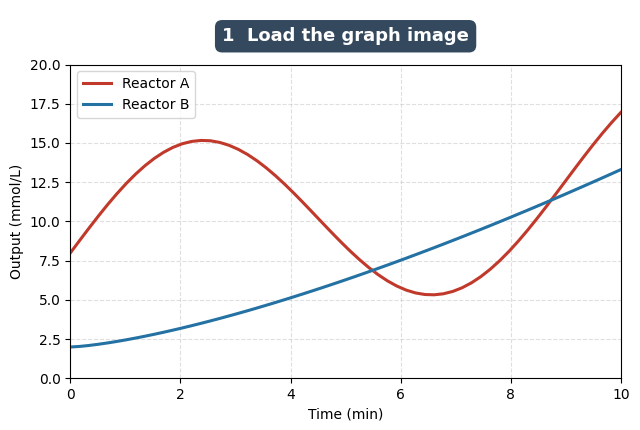
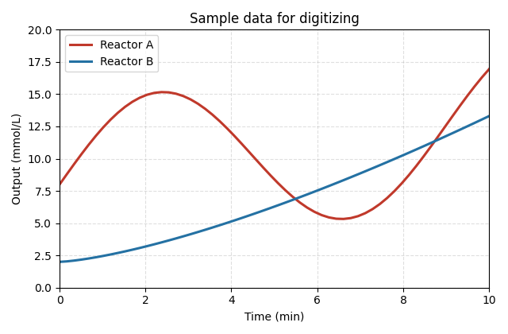

# Graph Digitizer

A client-side web app that turns a graph image into data. Load a screenshot or photo of a plot, calibrate the axes, extract the points (by hand or automatically by colour), and export a clean CSV. Everything runs in the browser: no server, no upload, nothing to install. That also makes it trivial to host for free on GitHub Pages (Settings → Pages → deploy from the `main` branch).

*(The walkthrough shows the original four-step flow; the layout has grown since, but the steps are the same.)*

## What it does

**Loading and calibrating**
- Loads an image by file picker, drag and drop, or clipboard paste.
- Calibrates from four reference points (X₁, X₂, Y₁, Y₂) or, with the corner toggle, two opposite corners of the plot area. Optional log scale on either axis.
- **Auto** next to each calibration point finds the axes and tick marks and places that point for you, independently of the others.
- **Read values (OCR)** reads the number printed next to each placed point (see [OCR](#ocr-for-axis-values)). X values come from the label under the tick, Y values from the label beside it.

**Extracting points**
- Click along a curve to add points, with a magnifier loupe. Optional **snap to the picked colour**. Drag a point to move it; arrow keys nudge it.
- **Automatic extraction by colour** with the *classic tracer* (default) or the *advanced tracer* (see [Tracers](#tracers)).
- **Several same-coloured curves** in one run, with **gap bridging** for dashed and dotted lines. Both work in either tracer.
- **Markers**: circles, triangles and squares, filled or outline. Pick the marker colour (or use Trace on one marker, which also measures its size); touching markers are separated and error bars, connecting lines and axes are ignored.
- Several series on one plot, each with its own colour and name. Clicking another series never interrupts renaming.

**Restricting where it looks**
- **Lasso**, **Box** and **Brush** (radius slider) regions per series. Plain drag replaces, <kbd>Shift</kbd> adds, <kbd>Alt</kbd> (or the Subtract checkbox) subtracts. Regions are tinted as you draw them.
- **Above / below another curve**: use an already-digitized series as a boundary. Drag the dashed line to shift it, or drag its nodes to reshape it, without touching the series' data.
- Without any region, extraction searches the calibrated plot area.

**Editing points**
- **Select** tool (box, lasso or brush): select many points, then drag, nudge with the arrow keys, or delete them together.
- Undo / redo, plus number keys to switch series and letter keys to switch tools.
- **Overlay** draws a line through each series to check the fit, as linear or spline. Points with a low match probability from the advanced tracer get an orange ring.

**Export**
- CSV in wide format (X,Y columns per series) or long format (series,x,y), with an editable file name, or copy straight to the clipboard.

**Layout**
- The sidebar is resizable (drag its right edge) and every panel collapses by clicking its title. Explanatory notes are hidden behind small **i** buttons.

## Try it in 60 seconds

A ready-made chart lives at `examples/sample-graph.png`. Load it and reproduce the numbers below.

1. Load `examples/sample-graph.png`.
2. Calibrate. Click "Set X₁", click the origin on the image, type `0`. "Set X₂", click where the x-axis reads 10, type `10`. "Set Y₁" at `0`, "Set Y₂" at `20`. (Or press **Auto** on each point, then type the values, or press **Read values (OCR)**.)
3. In "Automatic extraction", click "Pick colour", click on the red curve, then "Run auto extract". Add a second series and repeat for the blue curve.
4. Download CSV.

## Using your own graphs

1. Load a graph image.
2. Calibrate (four points or two corners; tick log X / log Y if needed).
3. Pick or add a series.
4. Extract: click points by hand, or pick the colour and run the automatic extraction. Restrict it with a lasso, box, brush or bound if other things share the curve's colour.
5. Check with the **Overlay**, fix points with **Select** / drag, then download the CSV.

The cursor readout at the top right shows live data coordinates once calibration is complete, so you can verify the mapping before extracting.

### Tools and shortcuts

| Tool | Key | What it does |
|---|---|---|
| Add | `A` | Click to add a point; drag or arrow-key a point to move it |
| Select | `S` | Box / lasso / brush-select points, then drag, nudge, or <kbd>Del</kbd> them all |
| Brush | `R` | Paint a search region (radius slider) |
| Delete | `D` | Click a point to remove it |
| Trace | `T` | Click a curve: picks its colour and runs the extraction |
| Lasso / Box | `L` / `B` | Draw a search region for the active series |
| Bound | `G` | Drag the above/below-curve boundary or its nodes |
| Pan | `H` | Drag to pan |

Also: `1`–`9` switch series, <kbd>Ctrl</kbd>+<kbd>Z</kbd> / <kbd>Ctrl</kbd>+<kbd>Y</kbd> undo / redo, <kbd>Esc</kbd> clears the point selection, <kbd>Ctrl</kbd>+wheel zooms.

## Tracers

**Classic tracer (default).** The original method, extended to several curves. For each column of the image it clusters the pixels of the picked colour, starts on the thickest cluster, and follows the cluster closest to the previous point. Gridlines, axes and text are rejected because they are thinner than the curve or too far from the previous point.

- *Same-coloured curves* (set the count): it starts where the curves are best separated, follows each outward, lets them coast through crossings where their ink merges, and never keeps two points in the same spot. The first curve fills the active series and the rest fill the following series, which are created if needed.
- *Bridge gaps* fills gaps up to the given length by straight interpolation (dashed and dotted lines, text crossing the curve). Set 0 to turn it off.

**Advanced tracer (optional).** Tick "Advanced tracer" for graphs the classic tracer gets wrong, such as bundles of dashed or dotted curves of one colour:

- Trace snaps to the nearest ink within 10 screen pixels of your click and starts exactly there, so it can't wander onto a legend or title.
- Each curve is found as the smoothest path through the ink (dynamic programming), so it crosses the gaps of dashed lines on its own momentum and is not pulled onto a neighbouring curve.
- Curves already digitized in other series count as taken, and "Curves never cross" keeps a new curve on its own side of them. Trace curves of a bundle one at a time from the top, each into its own series, or set the curve count and click the top curve.
- It sets the colour tolerance from the line's contrast when you use Trace.

## OCR for axis values

"Read values (OCR)" uses [tesseract.js](https://github.com/naptha/tesseract.js), which is loaded from a CDN **only when you first press the button** (about 3 MB, then cached by the browser). Nothing else on the page needs the network, and your image never leaves the browser. Always check the numbers it fills in; minus signs and small print are the usual casualties.

## Accuracy note

The pixel-to-data mapping assumes the axes are horizontal and vertical, which holds for essentially all screenshots and rendered charts. If you feed it a photo taken at an angle, straighten/crop it first. Calibration is most accurate when the reference points are far apart.

Automatic extraction assumes the curve is drawn at least as thick as any gridlines sharing its colour; that is how it tells them apart. Where same-coloured curves actually overlap (for example several curves converging to a single line) the image alone cannot say which is which: expect gaps or a few wrong points there, and use the overlay and the Select tool to check. Marker detection merges markers that overlap heavily. Tested on all-black plots (black curve, gridlines and axes) to a mean error under 0.2% of the y-range.

## Files

- `index.html` - markup and layout
- `styles.css` - styling
- `app.js` - all digitizer logic (no libraries; OCR is the one optional on-demand script)
- `examples/sample-graph.png` - a colour chart to practice on
- `examples/black-graph.png` - an all-black chart to test monochrome extraction
- `examples/two-curves.png` - two same-coloured curves that cross
- `examples/close-curves.png` - two same-coloured curves running close together, with tick labels for OCR
- `examples/dashed.png` - a dashed curve, for gap bridging
- `examples/markers.png` - filled circles, outline triangles and outline squares
- `docs/walkthrough.gif` - the original four-step demo above

When you change `app.js` or `styles.css`, bump the `?v=` number on their tags in `index.html` so browsers don't keep serving a cached copy.

## License

MIT. See `LICENSE`.
